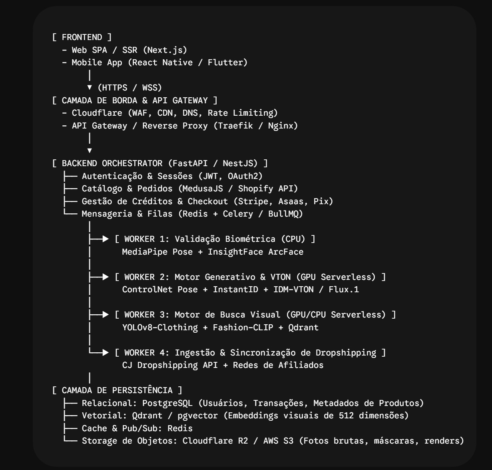

# Architecture reference and project workstreams

Updated 2026-11-10. The user supplied the diagram below as context for managing the project. It is a reference, not an instruction to install every listed component or replace confirmed provider decisions.



## How the reference maps to this MVP

| Reference layer | StylAI plan | Boundary / later options |
| --- | --- | --- |
| Frontend web/mobile | Preserve React/Vite responsive web in `apps/web`; account, try-on, catalog, cart/checkout/orders | Next.js SSR and React Native/Flutter are reference alternatives, not a rewrite instruction or current MVP deliverable |
| Edge/API gateway | HTTPS, CDN/DNS, WAF and coarse request limits; reverse proxy `/v1` to API, static assets to web | Cloudflare is a candidate. Use the host's ingress or one Nginx/Traefik layer where needed; do not stack gateways without a reason. App-level authorization/quotas remain mandatory |
| Backend orchestrator | TypeScript/Fastify modular API, Supabase Auth session adapter, catalog/order/payment orchestration | FastAPI/NestJS in the diagram are alternatives, not selected frameworks. No MedusaJS/Shopify dependency is assumed |
| Worker 1: photo validation | File safety, pose/framing guidance, consent, ownership, private ingestion; logical validation queue | Do not implement biometric identity recognition, face embeddings or ArcFace just because shown. MediaPipe/pose checks are optional after a demonstrated validation need |
| Worker 2: generation/VTON | Segmind IDM-VTON adapter with durable submit/poll/reconcile, cost reservation and private result delivery | No local GPU, ControlNet/InstantID/Flux stack is required by the selected hosted provider. One garment per evaluated render |
| Worker 3: visual search | Product-first category/style/variant selection plus verified product/result mapping | YOLO/Fashion-CLIP/vector search are later evaluated aids; do not invert the product-first decision into arbitrary image generation followed by approximate shopping matches |
| Worker 4: ingestion/sync | AliExpress/Shopee/TikTok Shop adapters, normalization, freshness, authorization and fulfillment checks | The diagram's CJ Dropshipping/affiliate examples are not selected integrations |
| Relational persistence | Supabase Postgres: users' app data, source identities, catalog, usage, jobs, orders/payment metadata | RLS, restricted RPCs, migrations and role tests remain authoritative |
| Vector persistence | None required initially; evaluate Supabase pgvector if real similarity retrieval justifies it | No Qdrant deployment or fixed 512-dimensional schema until the actual embedding model/use case is chosen |
| Cache/pub-sub/queues | Supabase/Postgres durable queues; browser polling already suits current contract | Redis/BullMQ/Celery/WSS are not required for the first release. Add only when measured needs justify cost and new failure modes |
| Object storage | Supabase private buckets for photos/masks/renders, approved public catalog media if permitted | R2/S3 remain future alternatives; do not maintain duplicate object authorities without a migration need |
| Payments | Required Asaas merchandise checkout, authenticated durable events and idempotent order/fulfillment/refund workflow | Asaas is selected; Stripe is not. Pix/card methods need account verification. No paid AI subscription implied |

## Proposed code boundaries

```text
apps/web/                       product UI and browser-safe contracts
apps/api/src/modules/           orchestrator domains and HTTP boundary
apps/worker/src/handlers/
  asset-validation.ts           worker 1 responsibility
  generation.ts                 worker 2 responsibility
  catalog-sync.ts               worker 4 responsibility
  fulfillment.ts                paid-order dispatch
  payment-reconciliation.ts     payment/order integrity
  cleanup.ts / deletion.ts      lifecycle and privacy
packages/ai/                    Segmind boundary and rendering evaluation
packages/commerce/src/sources/  three marketplace adapter implementations
supabase/                       schema, RPC, RLS, migrations, queue configuration
```

Worker roles are logical queues/modules first, not four mandatory services or local GPU servers. Initially deploy API and a bounded worker process separately. Independent handler queues and per-handler concurrency let validation, rendering, sync and order work avoid starving each other. Split processes only for measurable resource/isolation needs; paid order reconciliation and privacy cleanup must continue when inference is paused.

## Managing delivery

Use the following epics to organize issues and implementation checkpoints. They map to the detailed plan instead of introducing a second competing backlog.

| Epic | Detailed tasks | Evidence before Done |
| --- | --- | --- |
| E0 Decisions/access/licensing | T0, M0, C0 | Approved source capabilities, Segmind commercial-use confirmation and Asaas merchant/method configuration; rendering feasibility |
| E1 Workspace/edge/platform | T1-T3, T16 | Existing frontend preserved, CI, migrations/RLS, staging routing/secrets/health |
| E2 Auth/account/privacy | T4-T6, T14 | Verification/recovery, two-user isolation, lifecycle/deletion evidence |
| E3 Catalog/source adapters | T7, M1-M3 | All three normalized adapters/capability records, approved real products and freshness |
| E4 Photo validation | T8 | Consent/byte validation/private storage and mobile image acceptance |
| E5 VTON pipeline | T9-T12 | Product-first single garment, real Segmind evaluation, durable jobs/spend and restart tests |
| E6 Results/Closet/mapping | T9, T13 | Correct saved provenance, verified hotspots and accessible equivalent list |
| E7 Checkout/orders/fulfillment | T15, C1-C7, M4-M5 | Verified payments, source dispatch, tracking, refunds and reconciliation |
| E8 Release/operations | T16-T17 | Full actual staging journey, failures/drills, support owner and restore evidence |

Recommended issue states: **Backlog -> Ready -> In progress -> Review -> Verified in staging -> Done**. Blocked is explicit, with reason and owner; it is not Done. Every issue names its upstream dependency, affected module/contract, acceptance evidence and material external access dependency. Do not use mock-only tests to close an integration story.

Track decisions separately from tasks: **Confirmed by user**, **Engineering proposal**, **Externally verified**, **Unresolved**. Latest confirmed choices supersede previous proposals. A provider logo or a diagram label never upgrades “unresolved API access” to “delivered.”

Deliver vertical slices: catalog/verified account; photo->real Segmind result; result->cart->verified payment->source fulfillment; deletion/refund/recovery. Source onboarding, payment-provider access and commercial rights can run alongside workspace/auth work. No public issue tracker was modified and no external outreach was sent.
