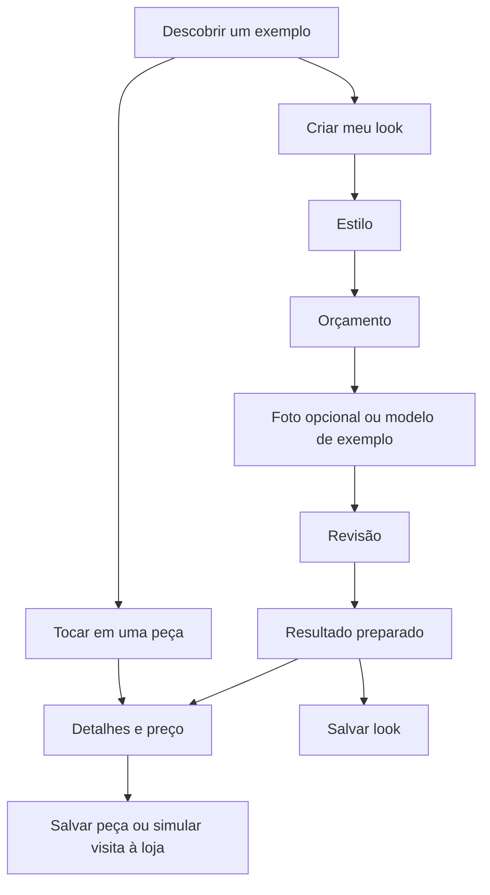

# Experiência e fluxo mobile

## Organização aprovada e implementada

| Destino | Função |
| --- | --- |
| Descobrir | Explorar exemplos e estilos antes de enviar foto |
| Provador | Criar ou retomar um look e suas escolhas |
| Salvos | Reabrir looks e peças individuais |

A barra inferior usa ícones com rótulos e estado ativo. Gerar é uma ação explícita dentro do Provador, não um efeito automático de tocar na aba.

## Primeiro acesso

A entrada recomendada e adotada é **exemplo primeiro**. Demonstra valor com pouco compromisso e é adequada ao protótipo que ainda não transforma a foto.

1. Ver um look preparado.
2. Encontrar uma dica contextual próxima da interação.
3. Tocar na roupa e ver seus detalhes.
4. Começar “Criar meu look” quando desejar.
5. Não repetir a dica após dispensá-la ou interagir.

A alternativa discutida foi começar pela foto; ela mostra personalização mais cedo, mas pede confiança antes de demonstrar valor.

## Fluxo do Provador

Se o orçamento não comporta o exemplo escolhido, explicar e permitir ajustar orçamento ou voltar ao estilo. Não substituir o estilo automaticamente.

## Resultado e detalhes

- Imagem completa, áreas de toque alinhadas e alternativa “Ver peças”.
- Salvar o conjunto ou só a peça.
- Informações da peça sem seleção de tamanho que não tenha efeito.
- Painel inferior com descrição rolável e ação da loja persistente.
- Fechar por botão, gesto na alça, Escape ou voltar do sistema.
- Preservar contexto e foco, inclusive ao fechar uma peça salva.
- Retomar etapas ao mudar de aba; não persistir fotos para isso.
- Respeitar movimento reduzido e navegação por teclado.

## Por que a revisão foi necessária

Na versão anterior, em 390 × 844 px, a imagem começava em 447 px e a dica de toque em 972 px. Havia muito conteúdo introdutório e uma página longa. Esses números são **do diagnóstico anterior**, não medições da revisão atual.

A revisão colocou o look, a explicação da interação e o botão de começar mais cedo, com navegação permanente.

Detalhamento original: [[Fonte - Analise UX mobile]]. Capturas: [[06 - Marca e ativos visuais]].

