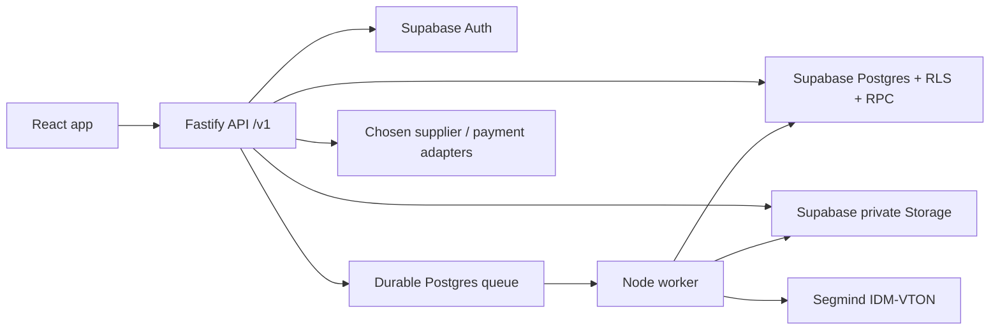

# StylAI — Supabase MVP design

Date: 2026-11-10. Status: proposed architecture and MVP scope, prepared at the user's request; planning only, not authorization to deploy or purchase services.

Supersedes `2026-11-10-monorepo-design.md`. Supabase replaces the standalone local PostgreSQL setup. The monorepo, API/idle-worker foundations and package boundaries are now implemented. Domain backend, Supabase project/schema and paid integrations are not. Read docs/START-HERE.md and the successor handoff for actual current status.

## 1. Decisions, proposals, and unresolved dependencies

**User direction (latest, 2026-11-10):** consolidate frontend and API in `stylai`; use Supabase; use **Segmind IDM-VTON** for virtual try-on; include **integrated merchandise payments in the MVP**; integrate **AliExpress, Shopee and TikTok Shop** as commerce sources. There is no imported catalog or verified provider account yet. Segmind supersedes the earlier tentative Luna idea; integrated payments supersede the earlier undecided checkout and external-checkout recommendation.

**Commerce scope:** track B (StylAI checkout, supplier fulfillment) is required for launch. Track A remains historical/optional referral context and does not satisfy the MVP. Asaas is selected; merchant/supplier accounts, methods, regional scopes and actual fulfillment paths still need verification. Interpret TikTok as TikTok Shop commerce, not video APIs. All three source adapters are planned; do not silently defer a source or assume a catalog/seller API supports buyer-side dropshipping.

**Engineering proposals:** TypeScript throughout, Bun workspaces, Fastify as a thin API/BFF, Supabase Postgres/Auth/Storage, a separate Node worker consuming a durable Postgres queue, curated catalog first, responsive web first. Retain the current React frontend rather than rewrite its design system. No Redis, Kubernetes, microservices, separate admin SPA, or mobile wrapper for the first release.

**Product proposals:** curated products from approved source connections; one source-and-seller fulfillment group per checkout; one garment per IDM-VTON render; one front photo; server-enforced free beta generation quota; no paid AI subscriptions; account required for private features; public exploration. Source onboarding may be sequenced, but omitting a requested source from launch requires an explicit scope decision. These limits are recommendations, not approved commercial terms.

**Launch dependencies:** Segmind access and confirmation of commercial IDM-VTON hosted-use rights; quality/cost evaluation; AliExpress/Shopee/TikTok Shop app approvals, regional scopes and supplier agreements; image-use permission; payment-provider/fulfillment readiness; hosting/domain/email; approved privacy/retention/support policy. See [Segmind integration](../../integrations/segmind-idm-vton.md), [connector plan](../plans/2026-11-10-marketplace-connectors.md) and [architecture reference](../../ARCHITECTURE-REFERENCE.md). Planning can proceed without credentials; integration cannot be certified without them.

## 2. What exists and what is missing

The original sibling `stylai_frontend` was copied with Git history, then migrated to `apps/web`. It uses React 19, Vite 6, TypeScript, Tailwind 4, TanStack Query 5, Bun tests and fixture-backed Playwright. Runnable API/idle-worker foundations and shared package boundaries now exist; real Supabase/domain/provider integration does not. Read [current handoff](../../handoff/CONTEXT.md) for delivered vs planned status. **Asaas is the confirmed processor**; older open-provider wording below must not reopen that decision.

Inspected current source:

- `src/api/client.ts`, `types.ts`, `parse.ts`, `http.ts`, and `queries.ts`: REST calls, tolerant parsers, in-memory access token, cookie refresh, polling, private queries.
- `src/auth/AuthProvider.tsx`: signup always expects a `Session`; Supabase email-confirmation signup requires a pending state instead.
- `src/auth/GoogleButton.tsx`: Google Identity Services ID token flow; optional and currently hidden without configuration.
- `src/app/routes.ts`, `screens/Auth.tsx`: hash routing and a custom reset token; email verification/recovery need explicitly designed callback handling.
- `src/app/useStudio.ts`: job submission has no idempotency key or explicit chosen body photo; job state is in UI memory.
- `src/screens/Studio.tsx`: image tap enlarges; no clothing-region mapping exists. Product copy currently permits “find similar after generation,” which conflicts with the documented product-first direction.
- `src/screens/Profile.tsx`: expects three body-photo slots and optional measurements; simplify for the initial single-photo flow.
- `src/components/StudioSheets.tsx`: exposes token plans, editing, and other advanced actions. Unsupported actions must be hidden by capabilities.
- `src/components/pieces.tsx`, `lib/links.ts`: outbound HTTPS links; there is no cart, checkout, order, or supplier fulfillment implementation.

The current `docs/API-CONTRACT.md` is a frontend expectation, not proof of backend delivery. Do not preserve insecure or incompatible assumptions merely to avoid updating it. Keep the contract, runtime schemas, parsers, and tests synchronized.

## 3. What “finished MVP” means

An invited user can discover real available products, create/verify an account, consent to upload a photo, choose a style and real products, receive an actual generated personalized preview, inspect the products represented, save the result, and complete the selected commerce journey. An operator can maintain the catalog, diagnose failures, remove inappropriate content, and handle the actual support obligations. The user can delete photos and request account/data deletion.

The system must not call a prepared image a personalized result, guarantee physical fit, invent product stock/ratings, or identify an approximate generated garment as an exact rendering. A clickable product region must map to an actual product and a verified location; invented hotspots are not acceptable.

### Launch scope

| Area | Required first release | Later or gated |
| --- | --- | --- |
| Catalog | Curated supplier products, variants, real prices, category/style, approved images, update/provenance data | Multi-supplier discovery and scraping |
| Accounts | Email/password, email verification, reset/change password, signout, deletion | Google optional after email flow works |
| Studio | Real garment/variant, one photo, category-aware IDM-VTON preview, durable job status, cancel/recover | Multi-garment rendering, text-to-image generation, free-form edits, Match feed |
| Results | Private image, real product mapping, verified hotspots + accessible product list, honest AI notice | Automatic high-precision segmentation if not proven |
| Closet | Save/remove products and looks, ownership and provenance | Social sharing/public profiles |
| Profile | Name, one front photo, consent, privacy/deletion controls | Side/profile photos and body measurements |
| Preferences | Budget, style and selected size if reliable supplier data exists | Rating/reviews/material/delivery constraints without reliable data |
| Generation usage | Server-owned free beta allowance and cost cap | Paid credits, subscription billing |
| Commerce | StylAI checkout, paid order, supplier acceptance, shipping/tracking, cancellation/refund/support | Mixed-source/seller carts, split payouts and multi-supplier shipments |
| Sources | AliExpress, Shopee and TikTok Shop adapters, approved catalog sync and verified fulfillment paths | Unapproved cross-market ordering and undocumented buying automation |

Integrated payments and fulfillment/refund behavior are required to launch. Outbound links alone do not finish the MVP. A source without approved fulfillment cannot sell through StylAI checkout until an API or authorized operational path is verified.

## 4. Architecture choices

### Alternatives

1. Browser talks to Supabase Auth and Data API directly: fewer HTTP handlers, but it replaces the existing cookie-session contract and spreads workflow logic across RLS/RPC and browser code. Good for a smaller CRUD app, less suitable for generation, commerce, and existing client compatibility.
2. **Recommended: thin Fastify API with Supabase as managed backend.** Keep the frontend REST boundary, centralize catalog mapping, auth cookies, abuse limits, job orchestration, and commerce integrations. User-data queries still use user-scoped Supabase JWTs and RLS; the API is not a blanket excuse to use elevated credentials.
3. Supabase Edge Functions for every endpoint: viable for short handlers, but duplicates routing concerns and does not eliminate the need for durable long-running generation execution. Reconsider hosting later if it reduces operations without weakening the queue guarantees.



Supabase is not the HTTP/worker hosting plan. Select a host supporting a Node API and a continuously running worker, health checks, HTTPS, secrets, and graceful termination. Serve `/v1` under the web origin through a reverse proxy where practical. Keep port 5190 for Vite and 3000 for the API in development, using the Vite proxy or exact allowed local origin.

### Repository after implementation

```text
apps/web/                    moved React frontend, existing visual system/tests
apps/api/src/
  app.ts                     server factory, dependency injection for tests
  server.ts                  startup, validated config, shutdown
  plugins/                   security, auth, Supabase clients, errors
  modules/                   auth, account, catalog, preferences, closet,
                             assets, studio, commerce, operations
apps/worker/src/
  main.ts                    polling lifecycle, health, shutdown
  handlers/                  generation, asset cleanup, account deletion,
                             required commerce fulfillment and source sync
packages/contracts/src/      browser-safe runtime schemas + DTOs
packages/supabase/src/       generated database types, user/admin client factories
packages/ai/src/             provider adapter, prompt versioning, evaluation
packages/commerce/src/       payment/supplier interfaces + three source adapters
supabase/config.toml         local configuration and reproducible settings
supabase/migrations/         single source of schema/RLS/RPC changes
supabase/tests/              database/RLS/invariant tests
supabase/templates/          verification and recovery emails
scripts/                     guarded catalog import and operator commands
docs/                        API contract, design, execution plan, runbooks
.github/workflows/           verification and controlled release workflows
package.json + bun.lock      one private workspace, one dependency lockfile
```

Keep the root `.git` and existing history, with no nested repositories. Leave `../stylai_frontend` and the original prototype unchanged. API and worker share contracts and adapters; neither imports web screens. Web never imports `packages/supabase` admin exports, worker code, or provider credentials.

## 5. Supabase setup, migrations, and access control

Use distinct development, staging, and production Supabase environments. A local Supabase CLI stack is optional for development/CI; it replaces a bespoke native PostgreSQL setup. Do not point tests or reset scripts at production. Use CLI migrations and generated DB types; do not also introduce an ORM migration ledger.

The initial runtime accesses user data through `@supabase/supabase-js` with a publishable key plus the validated user's access token. RLS is enforced even if a caller invokes the Data API outside the BFF. Keep secret-key clients separate and server-only for narrowly defined Auth admin, session-vault, validated object ingestion, cleanup, and worker operations. Do not use the `postgres` database owner as application runtime identity. Storage policies deny direct browser-role INSERT/UPDATE/DELETE on private asset buckets; otherwise a user JWT could bypass byte validation, consent and quota enforcement. Owner reads require active session and a ready asset; object mutation and cleanup go through the BFF/worker. Test these policies through direct Storage API calls, not only HTTP handlers.

Enable RLS, explicit table/column privileges, and default-deny policies in the migration creating every exposed table. Anonymous users can read only published catalog rows. Users can read their own profile/preferences/assets/looks/jobs/closet. They cannot mutate credits, billing flags, catalog approval, ownership IDs, job state, or generated outputs. Read policies must also reject deleted/deleting accounts and revoked app sessions. Use a narrowly scoped `private.is_active_session()` security-definer predicate with a fixed search path to check the Supabase JWT `session_id` against active server sessions; never expose encrypted sessions.

Use SQL RPC functions for multi-table changes: create generation + reserve quota + enqueue atomically; finalize job + create look + spend allowance atomically; cancellation; save look with piece provenance; begin account deletion. For each function declare exact allowed roles, revoke default PUBLIC execute, validate ownership and inputs internally, and set a fixed safe search path. Worker finalization and admin operations are not executable by anonymous/authenticated clients. Any authenticated enqueue RPC must enforce the same owner, consent, capability, quota, and payload constraints when called directly without Fastify.

No production data in seeds. Synthetic fixtures belong only in isolated tests. Real catalog import validates supplier identifiers, HTTPS destinations, image-use rights, currency/amounts, and variant relationships; records a batch/source manifest; defaults to draft; supports a dry-run; and does not overwrite fields silently.

## 6. Database model

Use UUIDs, UTC timestamptz, foreign keys, explicit statuses and uniqueness constraints, and indexes for real filters/owner queries. Store prices/costs as integer minor units with currency; do not combine different currencies into a total.

| Group | Tables and essential invariants |
| --- | --- |
| Auth/profile | Supabase `auth.users`; `profiles(id -> auth.users, name, deletion_state)`; never store password hashes ourselves |
| BFF session vault | `private.app_sessions(cookie_hash unique, user_id, provider_session_id, encrypted access/refresh tokens, token_expiry, absolute_expiry, revoked_at, refresh_lease_until, version)`; inaccessible to browser roles |
| Catalog | `partners`, `categories`, `styles`, `products`, `product_images`, `product_variants`, `product_styles`, `catalog_imports`; supplier/product/variant IDs unique, published flag and rights/source timestamps |
| User selections | `preferences(user_id, rules, version)` and a default preference reference; bounded validated JSON, owner-only |
| Assets | `assets(user_id, kind, bucket, object_key, mime, bytes, dimensions, status, retention_until, consent_version)`; object keys never accepted directly from clients |
| Generation | `generation_jobs(user_id, kind, status, request_key, payload_hash, normalized_input, policy/prompt/model versions, provider_request_id, lease, attempt, progress, error)`; unique `(user_id, request_key)` |
| Result provenance | `looks(user_id, image_asset_id, origin, parent_id, version)`; `look_pieces(look_id, product/variant_id, snapshot, role, hotspot, mapping_source, verified_at)`; never lose which real products were sent to the model |
| Closet | `closet_pieces(user_id, product_id, explicit_favorite)`; `closet_looks(user_id, look_id)`; look-to-piece source links avoid removing an explicit favorite when a look is unsaved |
| Usage | `usage_periods(user_id, period_start, granted, reserved, spent)` and append-only `usage_events(job_id,event_kind,units)` with unique event constraints and nonnegative invariants |
| Operator AI spend | private `provider_spend_periods` and `provider_attempts(job_id, attempt_id, fence_token, operation_kind, reserved_max_minor, actual_minor, currency, provider_id, outcome)`; atomic maximum reservation before every billable call; unresolved outcomes remain reserved |
| Operations | private `deletion_requests`, `audit_events`, queue/dead-letter records, supplier click events with short retention and no raw photos/prompts |
| Commerce required | carts/cart_items, address snapshots, quotes, orders/order_items, payment_attempts, payment_events, supplier_orders, shipments, refund_requests, fulfillment_events, reconciliation_runs |
| Procurement control | private funding sources/reference vault, procurement budget/reservations/events, currency/FX policy and purchase evidence; distinct from customer collections and AI usage/spend ledgers |
| Source connections | private token vault, account/shop/region/scopes, external listing/variant mappings, sync checkpoints, capability evidence and fulfillment mode |

The operator import workflow and selected supplier determine required variant fields before catalog migrations are finalized. Catalog records must distinguish supplier cost from public selling price; never expose wholesale cost or supplier credentials in public DTOs. Commerce B needs product/variant/price/shipping snapshots at order time; later catalog edits cannot rewrite a paid order.

## 7. Authentication and browser changes

Keep Supabase as the identity authority. The API calls its email/password/verification/recovery methods; do not reimplement password storage, email-token issuance, or Google token verification.

Recommended BFF session design: browser gets a short-lived Supabase access JWT only in memory and a random 256-bit opaque app-session cookie (`HttpOnly`, production `Secure`, host-only, `SameSite=Lax`, `Path=/`). Store only its SHA-256 lookup hash in the private session table; encrypt provider tokens using authenticated encryption and an environment-owned versioned key. Cap app sessions at 7 days for the beta. Cookie is stable across refresh, reissued on reauthentication; revoke it on logout/password reset/deletion. Never expose provider refresh tokens to browser JavaScript.

Every protected API request verifies the JWT cryptographically, requires its `sub` and Supabase `session_id` to match the active cookie session, and checks deletion/revocation. User-scoped Data API reads use that JWT. Server refresh is coordinated with a database lease/CAS per session, not just an in-process promise: one request refreshes provider tokens, followers reuse the committed current access token. Test two API instances and two browser tabs. Provider rotation and the local vault commit cannot be one transaction: if the process dies after rotation, permit bounded recovery only within documented provider reuse behavior, fence a delayed old refresh result by vault version, then revoke the app session and require sign-in if the outcome remains indeterminate. Never persist a stale refresh result over a newer version. Use request-scoped SDK clients with persistence and SDK auto-refresh disabled. API auth/private responses are `Cache-Control: no-store`; never cache `Set-Cookie` responses at the CDN.

Require an exact allowlisted Origin and Fetch Metadata policy for state-changing browser requests, including refresh and signout. Bearer authorization remains required for protected mutations. Confirmation/recovery links are the explicit token-based exception and need single-use checks and safe navigation, not arbitrary redirect URLs. CLI/worker authentication is separate.

### Contract corrections

- `POST /auth/sign-up` returns `202 { status: "verification_required" }` when confirmation is required; do not issue a fake access token. Generic response avoids claiming whether an existing account is registered. Update `AuthProvider`, signup screen and parsing with a discriminated result.
- Add `POST /auth/email/verify` accepting a token hash and fixed `signup` verification purpose. Email links enter `/#/confirmar-email?token_hash=...`; show an explicit confirmation screen and submit by POST so simple email-link scanning does not consume the token. Clear secrets from browser history immediately after capture.
- Recovery email opens `/#/redefinir-senha?token_hash=...`; reset POST verifies a recovery OTP with Supabase, updates password in a restricted recovery flow, and revokes app sessions. Do not accept a provider access token as a password-reset token. No provider URL fragment should collide with the app's hash router.
- Current-password change must reauthenticate, update through Supabase, and invalidate other app/provider sessions with explicitly tested scope.
- Configure Portuguese templates, strict redirect allowlists, and production SMTP. Google stays hidden until its chosen Supabase flow is validated; do not auto-link accounts merely because an unverified email matches.
- Return sanitized Portuguese errors with field details only where safe. Map provider error codes, not fragile provider message strings.

## 8. Catalog, selection, and commerce foundation

No catalog exists yet. Build source-specific AliExpress, Shopee and TikTok Shop adapters and a normalized catalog, plus an authorized CSV/JSON onboarding bridge. Operator approval publishes imports; no public write endpoints. Proposed beta baseline: 20 approved real products overall, with each enabled requested source represented by verified data and fulfillment. Preserve source, shop/seller, region, product/variant IDs, rights, timestamps and purchasing capability. App access is not supplier permission. This is a baseline, not a business forecast.

Select products before image generation. Enforce hard filters using actual data, rank soft preferences deterministically, and pass only the selected products plus permitted images to the model. Do not let a model invent product IDs or override prices. For missing ratings/size/stock, follow the user's missing-data rule; never manufacture a score. Hide unsupported filters. Keep strict budget across a known currency and show shipping/taxes separately where applicable.

Cursor pagination is deterministic and filter/sort-bound: validated opaque cursor includes sort key and UUID tie-breaker. Null price sorts last. Price ascending/descending use price+UUID, newest uses timestamp+UUID, relevance uses stable rank+UUID. Reject a cursor reused with different filters, unsupported currency, invalid limit, or malformed query. Avoid a blanket created_at cursor for every sort.

### Commerce A — historical/optional supplier checkout

Show real supplier/price/update data and an honest external-store action. Use server-validated allowlisted destinations; no open redirect. Click tracking is best-effort and cannot block navigation. Respect partner rules that may forbid link wrapping; when necessary keep the original affiliate link and record an asynchronous product click. No claim of a tracked sale or commission without an actual report. No own cart, payment, order promise, or inventory reservation. The product should describe this as referral/intermediation, not imply StylAI collected payment.

### Commerce B — required MVP: StylAI checkout, supplier fulfills

This is an additional launch-critical subsystem. Use a payment-service checkout/hosted fields; never handle card numbers. Pick provider and payment methods after commercial review, including whether Pix is required. The commerce plan must cover server-side repricing, variant/stock check, delivery quote, expiring quote, immutable order snapshot, payment idempotency, provider-authenticated webhooks (raw-body signatures where applicable), duplicate/out-of-order events, supplier acceptance/rejection, tracking, cancellations, returns, refunds, disputes, reconciliation, and support ownership.

Do not fulfill from the browser success redirect. Fulfill only from verified captured/settled payment state and an atomic outbox transition. One supplier-order idempotency key per paid order prevents duplicate purchase. If stock/price changes or supplier rejects after capture, enter an explicit operator-visible exception with a refund path. For a supplier without an ordering API, a private manual fulfillment queue and tested operator procedure are acceptable for beta; automatic ordering cannot be claimed.

An order has a unique consumed quote and at most one active payment attempt. Different caller keys cannot create multiple payable orders from one quote. Late provider success after expiry/replacement is reconciled as actual money received, never discarded or turned into a second supplier purchase. Confirm procurement working capital and approved supplier-payment method separately from customer collection; reserve private procurement budget/FX allowance before supplier dispatch and handle `funding_required` explicitly. Payment capture does not establish available settled funds. Detailed states/tests are in commerce C0/C2-C5.

Never use generation credits as order payment or mix AI usage allowances with merchandise billing. Confirm taxes, invoicing, seller identity, returns, shipping commitments, and support responsibility with the responsible business/legal advisers before accepting public orders. This document identifies work; it is not a jurisdiction-specific legal conclusion.

## 9. Assets, consent, generation, and cost controls

Private buckets: `body-photos`, `references`, `generated-looks`; a separate public catalog-image bucket only for rights-cleared public assets. Store object keys, not expiring signed URLs, in database rows. Authorized API serializers issue short-lived URLs (proposed 5 minutes). Web refetches the owning resource once on signed-image expiry, preserving in-progress input; it must not retry every broken image indefinitely. Signed links can remain usable until expiry even after access is revoked; do not promise instant invalidation.

Uploads: multipart field `file`, JPEG/PNG/WebP only, 12 MiB max, decoded minimum height 600 px, maximum 24 megapixels, reject animated/corrupt files, decode/re-encode to strip metadata and check actual bytes. Random owner-scoped keys. Limit concurrent uploads and per-user storage. Rejected input never becomes `ready`. Server validates file ownership, consent version and expiry again when a job is submitted. Reference-image ingestion is disabled initially unless the chosen generation workflow actually needs it.

Proposed beta retention: unreferenced temporary uploads 24 hours; body photos and unsaved generated looks 30 days, with notice; saved looks remain until deletion/account closure. Referenced look output must not be removed by a temporary-upload sweep. Original body photo deletion does not silently imply the generated derivative was also deleted: provide a clear “delete my photos and generated previews” flow. Provider retention/training settings and deletion capabilities must be verified and reflected in the notice before real customer photos are processed.

### Segmind IDM-VTON provider decision

Segmind IDM-VTON is selected, superseding Luna/OpenAI image generation. Use a server-only `SEGMIND_API_KEY`, model slug `idm-vton`, and a Segmind adapter. No OpenAI orchestrator is required for this flow. Details and commercial-license gate: [Segmind integration](../../integrations/segmind-idm-vton.md). No live request or paid test has been performed.

The provider adapter accepts one approved garment/variant and an owned ready photo. Store an external request ID and poll durably, then copy validated output to private Supabase Storage. Product/style text drives selection and a bounded catalog-derived garment description, not general image generation. No arbitrary image URL fetching or model-written DB mutations. The API contract does not establish multi-garment rendering, footwear support, image-region localization or a fit guarantee; keep those capabilities disabled until separately validated.

Before full Studio implementation, evaluate 20 consented, rights-cleared single-garment cases across enabled categories and poses. Record identity/garment correspondence, failures, latency and per-success cost. Proposed gate: 18/20 acceptable under human review, no unsafe outputs, p95 below 120 seconds and an approved cost ceiling. Failure requires a reviewed product/provider change, not silent substitution or a collage labeled as personalized try-on.

### Durable jobs

Use Supabase Queues/pgmq with `generation_jobs` as the source of truth. Enqueue in the same database transaction as the job and usage reservation. A worker claim/visibility lease must be renewed; acknowledge only after a committed terminal state. Treat execution as at-least-once: delivery windows do not make external AI calls exactly once.

API accepts `Idempotency-Key` for each new generation. Same user/key/payload returns the existing job; same key/different payload is 409. Snapshot products, selected photo, consent, rules, quota/cost/model/prompt versions at submission. Persist provider operation ID before awaiting completion when supported. If a network timeout leaves provider outcome unknown, reconcile instead of blindly submitting another billable request; if provider lookup/idempotency is unavailable, flag an operator exception and do not auto-retry the paid submission.

State machine: `queued -> running -> succeeded | failed | no_results | cancelled`. Running steps expose selection, rendering and verification through `step`, not fabricated percentages. Each worker claim increments a fencing token; dispatch authorization, progress updates and terminal transitions compare that token transactionally. Cancellation/deletion invalidate the current token. Workers recheck cancellation/deletion before dispatch and before publishing; a stale claimant can never publish or spend units. A vendor call already accepted before fencing may still incur operator cost, so reconcile it without publishing. Retry known-safe transient operations at most 3 times with backoff; provider submission retry requires proven idempotency. Stale leases requeue safe work; irreconcilable work enters dead-letter/failed handling and releases the user's reservation exactly once.

One active job per user initially. Proposed allowance: 3 units per UTC day, generation/try-on 1 unit each, no paid plans. SQL reserves available units at enqueue and spends them only on success; failure/no-results/cancel releases them. Snapshot the period at enqueue so a job crossing midnight cannot corrupt the next day's balance. `tokens` in the current DTO means available free units after reservations; update UI wording to “gerações disponíveis” and disclose the UTC reset time locally. Global daily provider spend cap, max concurrent jobs, timeout, and kill switch are server-enforced. A separate operator spend ledger atomically reserves a conservative configured maximum before every billable generation, localization or retry call, then reconciles measured costs. Input/output size/quality limits must make that maximum defensible; unknown maximum means dispatch is blocked. Unknown provider outcomes keep their spend reservation until reconciled, even when the user's free units are released. Actual provider costs for failed/cancelled work still count against operator spend limits. No in-memory counter can authorize paid dispatch.

### Personalized preview and hotspots

Initial generation requires `mode: "personalized"`, `styleId`, an owned ready `bodyPhotoId`, one product ID and its selected variant ID. Snapshot that garment/photo pair; reject multiple garments or unsupported categories before reserving spend. Set `maxChosenPieces=1`, `personalizedPreview=true`, `outfitPreview=false`; keep broader saved outfits separate from what the render actually represents. Multi-piece sequential rendering is a later evaluated feature. Photo replacement cannot alter an already submitted input snapshot.

Add normalized bounding rectangles per `LookPiece`: `{ x, y, width, height }`, each in [0,1], plus mapping provenance. Persist only verified regions; clip/reject out-of-range or mismatched product IDs. Render regions relative to the actual image's contain/cover geometry, support keyboard/touch, and retain the full equivalent product list. A vision/localization pass can propose mappings but cannot certify them by itself. If automatic verification fails, the controlled-beta operator queue must validate/annotate before publishing, or the UI must explicitly withhold unverified regions. The launch gate requires the promised clickable-clothing interaction to work on the evaluated results.

## 10. API and frontend compatibility

Detailed route coverage and file changes are in `../plans/2026-11-10-supabase-mvp-api-matrix.md`. Preserve Portuguese messages, safe HTTPS partner links, UTC dates, null unknown values, and JSON error envelopes. Add capabilities to Studio config rather than simulating supported features. Disabled features return a stable `feature_unavailable` error if called directly.

Frontend must add verification-required signup, confirmation/recovery handling, capability-driven controls, product-first copy, style/photo selection and consent, submit idempotency, server job recovery after reload, quota wording, signed-image renewal, hotspots, and the selected commerce journey. Query keys must be user-scoped or cleared comprehensively on session change, including hero/product personalized flags. Reset private drafts and object URLs on signout; current `AuthProvider` query clearing does not reset the whole UI store. Never persist photos or access/refresh tokens in localStorage.

Preserve current hash navigation and design tokens unless a route requires a small deliberate extension. Support back navigation, keyboard/focus, reduced motion, mobile camera/gallery, loading/empty/error/retry states, and honest provider failures. Fixture-only E2E tests remain useful but do not prove a real Supabase or AI integration.

## 11. Operations, release, and definition of done

- Pin dependencies/CLI at implementation; one workspace lockfile. Root scripts for dev web/API/worker, typecheck, lint, unit/contract/integration/E2E checks, Supabase start/status/migrations/typegen. API on Node 22+ with a pinned supported runtime; Bun is package manager/test runner, not an assumed substitute for Node production behavior.
- CI: typecheck, lint, build, unit/contract tests, isolated Supabase migration/RLS/integration tests, browser E2E. Integration tests use actual anon/user/admin roles and two separate users. No cloud/project mutation is part of this planning task.
- Staging: separate keys/data, real email callbacks, controlled provider tests, real supplier links or payment sandbox, restart/retry/cancellation drills. Real mobile device acceptance complements emulation.
- Production: same-origin HTTPS routing, strict CORS fallback, CSP with explicit API/image/Google origins only when used, HSTS on HTTPS, request/upload limits, log redaction, environment validation, no public sourcemaps containing sensitive server material.
- Metrics: API errors/latency, auth failures, queue depth/oldest age, job completion/failure/retries, provider spend per attempt/success, cleanup backlog, catalog freshness, outbound clicks; required payment/order reconciliation and fulfillment exceptions. Exclude photos, secrets, complete prompts, payment data, and signed URLs from telemetry.
- Runbooks: broken supplier link/unavailable item, provider outage, stuck/unknown job, spend kill switch, account/data deletion, image moderation/report, leaked key rotation, backup/restore, reversible deployment rollback. Commerce B adds delayed fulfillment, cancellation, returns/refunds/disputes, and reconciliation.
- Confirm backup/restore and Storage object recovery separately for the selected Supabase plan; a database backup is not evidence that every object binary is recoverable. Define data export and provider-exit procedures.
- Account deletion returns `202 { deletionId, status: "pending" }`; immediately revoke active app sessions and stop new work, then retry object/provider cleanup and Auth deletion durably. UI shows accepted deletion, not a false completed wipe. Track an operator SLA, minimal deletion tombstone, and documented backup/provider-retention limits. Commerce B order/payment/refund/fulfillment records use deletion-aware foreign keys and minimized retention independent of the auth user; do not cascade-delete obligations still needed for delivery, disputes or refunds. Remove account access and photo assets immediately while handling retained commerce identifiers under a separately approved policy and support verification procedure.

**Release gate:** a real staging journey passes from supplier catalog import through verification, photo consent/upload, product-first personalized generation, mapped result, save/reload, selected commerce completion, photo/account deletion, and a failure/retry scenario with no duplicate charge or order. No exposed secret keys, cross-user reads, publicly accessible personal photos, unsupported active controls, or unowned data writes. Every deferred feature is hidden. No claim of complete MVP before these gates are evidenced.

## 12. Source references checked on 2026-11-10

- Supabase auth sessions and rotation: https://supabase.com/docs/guides/auth/sessions
- Supabase SSR architecture/cookie distinction: https://supabase.com/docs/guides/auth/server-side/advanced-guide — the proposed custom BFF vault is our architecture choice, not the browser/SSR package's default behavior.
- Confirmation-required signup: https://supabase.com/docs/reference/javascript/auth-signup
- Email templates and token hashes: https://supabase.com/docs/guides/auth/auth-email-templates
- Production SMTP: https://supabase.com/docs/guides/auth/auth-smtp
- RLS and elevated keys: https://supabase.com/docs/guides/database/postgres/row-level-security
- SQL function permissions: https://supabase.com/docs/guides/database/functions
- Private storage and signed access: https://supabase.com/docs/guides/storage/buckets/fundamentals
- Durable queue and visibility: https://supabase.com/docs/guides/queues
- Edge execution limits: https://supabase.com/docs/guides/functions/limits
- Migration workflow: https://supabase.com/docs/guides/local-development/database-migrations
- IDM-VTON API: https://www.segmind.com/models/idm-vton/api
- Segmind SDK and idempotent async submission: https://docs.segmind.com/docs/sdks/javascript
- Model license information: https://www.segmind.com/models/idm-vton

Recheck current provider behavior, account access, supported tool/model combinations and costs before implementing or spending. Public documentation does not prove this account's access or the quality of personalized garment rendering.
